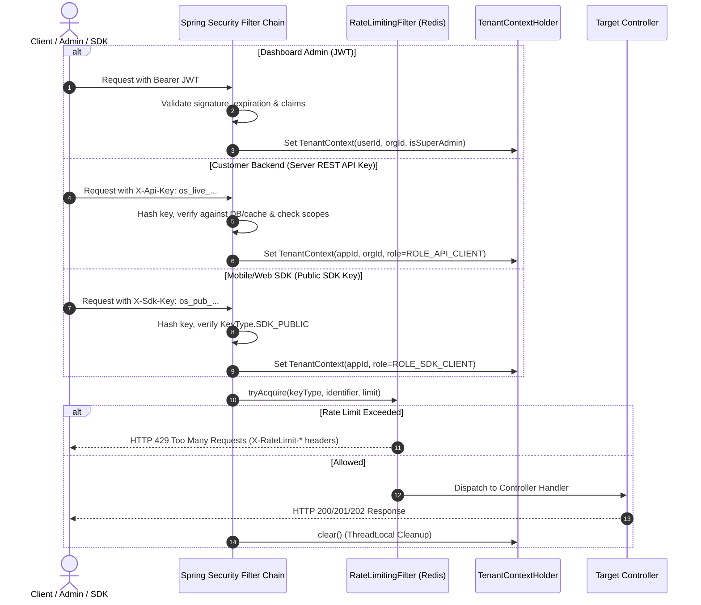
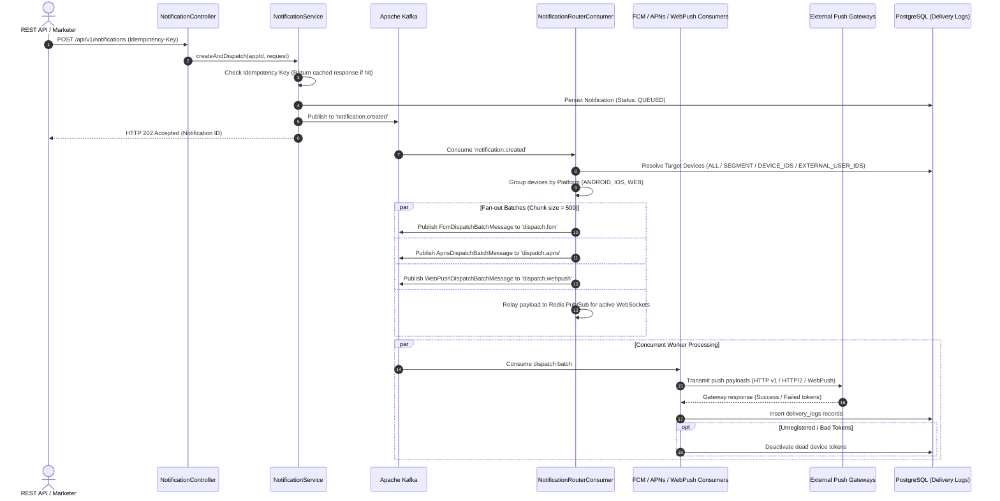

# OneSignal-Grade Multi-Tenant Push Notification Engine
## Backend Architecture, System Processes & Data Flow Documentation

> **Authored by:** Senior Systems / Platform Engineer (OneSignal Alumni)  
> **Target Audience:** Backend Engineers, System Architects, DevOps, AI Coding Agents  
> **Project Scope:** `backend/` (Spring Boot 3.3.4, Java 21, PostgreSQL 16, Redis 7, Apache Kafka, Flyway, ShedLock)

---

## 1. System Overview & Architectural Topology

The backend is built as a **high-throughput, multi-tenant modular monolith** adhering to Clean Architecture / Domain-Driven Design (DDD). It mirrors enterprise-grade push notification platforms (such as OneSignal, Firebase Cloud Messaging, and Braze) designed to process billions of messages with low latency, strict tenant isolation, at-least-once delivery guarantees, and automatic device token lifecycle management (churn handling).

### Core Architectural Pillars
1. **Multi-Tenancy & Tenant Isolation:** Every request is authenticated and strictly isolated at the Organization and App level using `TenantContextHolder` (ThreadLocal) and scoped database queries.
2. **Asynchronous Non-Blocking Fan-Out:** HTTP API calls do not block on third-party push gateways. Requests are validated, assigned an idempotency key, written to the database, and dispatched as Kafka events.
3. **Dedicated Provider Dispatch Pipelines:** Platform-partitioned Kafka topics (`dispatch.fcm`, `dispatch.apns`, `dispatch.webpush`) feed specialized consumers operating in batches of 500 recipients.
4. **Resilient Token Lifecycle & Churn Deactivation:** Gateway feedback (e.g., APNs `BadDeviceToken`/`Unregistered`, FCM `UNREGISTERED`/`NOT_FOUND`, WebPush `410 Gone`/`404`) automatically triggers device deactivation to eliminate wasteful traffic.
5. **Zero-Knowledge Credential Vault:** Provider secrets (FCM Service Account JSON, APNs `.p8` private keys, WebPush VAPID private keys) are encrypted at rest using AES-256-GCM.
6. **SSRF Hardening:** All WebPush subscriber endpoints undergo DNS validation to prevent Server-Side Request Forgery against internal cloud metadata (e.g., `169.254.169.254`) and private RFC-1918 subnets.

---

## 2. High-Level System Architecture Diagram

```mermaid
flowchart TD
    subgraph Clients["Clients & Gateways"]
        AdminUI["Vue 3 Admin Dashboard"]
        CustServer["Customer Backend (REST API)"]
        MobileSDK["Mobile / Web Apps (Client SDK)"]
    end

    subgraph Edge["Security & Ingress Layer"]
        FilterChain["Spring Security Filter Chain"]
        JWT["JwtAuthFilter (Bearer token)"]
        APIKey["ApiKeyAuthFilter (X-Api-Key / X-Sdk-Key)"]
        RateLimiter["Redis Sliding-Window Rate Limiter"]
        TenantCtx["TenantContextFilter"]
    end

    subgraph CoreModules["Modular Monolith Domains"]
        IAM["IAM & RBAC<br/>(Users, Orgs, Permissions)"]
        AppMod["App Management & AES-GCM Vault"]
        DeviceMod["Device Registration & Tags"]
        SegmentMod["Dynamic Audience Filter Engine (AST)"]
        NotifMod["Notification & Campaign Orchestrator"]
        SchedMod["Distributed Campaign Scheduler (ShedLock)"]
        EventMod["Client Telemetry Ingest"]
        RealtimeMod["WebSocket STOMP Broker"]
        AnalyticsMod["Aggregations & Rollups"]
    end

    subgraph Queues["Event Backbone (Apache Kafka)"]
        TopicNotif["notification.created"]
        TopicFCM["dispatch.fcm"]
        TopicAPNS["dispatch.apns"]
        TopicWebPush["dispatch.webpush"]
        TopicEvents["events.ingest"]
        TopicDLQ["dispatch.dlq"]
    end

    subgraph Workers["Dispatch Workers & Gateways"]
        RouterWorker["Notification Router Consumer<br/>(Fan-out in batches of 500)"]
        FCMWorker["FCM Multicast Dispatcher (HTTP v1)"]
        APNSWorker["APNs HTTP/2 Dispatcher (JWT Auth)"]
        WebPushWorker["WebPush Dispatcher (RFC 8291/8292 VAPID)"]
        EventWorker["Event Ingestion Consumer"]
    end

    subgraph ExternalGateways["Third-Party Push Gateways"]
        FCMGate["Google FCM HTTP v1"]
        APNSGate["Apple APNs HTTP/2"]
        WebGate["Browser WebPush Services (Mozilla/Chrome/Edge)"]
    end

    subgraph Storage["Data & Cache Tier"]
        PG[(PostgreSQL 16 Multi-Tenant)]
        Redis[(Redis 7 Cache, Rate Limiting & Pub/Sub)]
    end

    %% Client routing
    AdminUI --> FilterChain
    CustServer --> FilterChain
    MobileSDK --> FilterChain

    %% Ingress to filters
    FilterChain --> JWT
    FilterChain --> APIKey
    JWT --> TenantCtx
    APIKey --> TenantCtx
    TenantCtx --> RateLimiter

    %% Ingress to Modules
    RateLimiter --> IAM
    RateLimiter --> AppMod
    RateLimiter --> DeviceMod
    RateLimiter --> SegmentMod
    RateLimiter --> NotifMod
    RateLimiter --> EventMod
    RateLimiter --> RealtimeMod

    %% Processing & Scheduling
    NotifMod --> TopicNotif
    SchedMod -->|ShedLock Lock| NotifMod
    EventMod --> TopicEvents

    %% Kafka Fanout
    TopicNotif --> RouterWorker
    RouterWorker -->|Segment / Target Resolution| PG
    RouterWorker --> TopicFCM
    RouterWorker --> TopicAPNS
    RouterWorker --> TopicWebPush
    RouterWorker -->|Foreground Relay| Redis

    %% Worker Execution
    TopicFCM --> FCMWorker
    TopicAPNS --> APNSWorker
    TopicWebPush --> WebPushWorker
    TopicEvents --> EventWorker

    FCMWorker --> FCMGate
    APNSWorker --> APNSGate
    WebPushWorker --> WebGate

    %% Failures & Retries
    FCMWorker -->|Unregistered Token| DeviceMod
    APNSWorker -->|Bad Device Token| DeviceMod
    WebPushWorker -->|410 Gone / 404| DeviceMod
    FCMWorker -.->|Fatal Error| TopicDLQ
    APNSWorker -.->|Fatal Error| TopicDLQ
    WebPushWorker -.->|Fatal Error| TopicDLQ

    %% Data persistence
    Workers -->|Delivery Logs| PG
    EventWorker -->|Partitioned Events| PG
    RealtimeMod <--> Redis
```



---

## 3. Modular Monolith Directory Structure

Each domain module lives in `com.onesignal.platform` and follows strict DDD layering:
- `api/`: REST Controllers, WebSocket controllers, and Request/Response DTO records
- `application/`: Transactional application services orchestrating business logic
- `domain/`: JPA entities, enums, domain events, and value objects
- `infrastructure/`: Spring Data JPA repositories, Redis adapters, Kafka producers/consumers, external HTTP clients

```
com.onesignal.platform
├── analytics/         # Aggregated CTR%, hourly/daily delivery stats, platform rollups
├── apikey/            # REST (os_live_*) & SDK (os_pub_*) API key lifecycle, hashing, scopes
├── app/               # Multi-tenant App entities & AES-256-GCM Credential Vault
├── audit/             # Compliance audit logs, actor snapshots, admin operation tracking
├── common/            # Shared Kernel: Security filters, TenantContext, Redis, Kafka, ShedLock
├── device/            # Device registration, platform types (ANDROID, IOS, WEB), EAV tagging
├── dispatch/          # Kafka routers, batching (500/chunk), FCM, APNs, WebPush workers, SSRF validator
├── event/             # Client telemetry ingestion (DELIVERED, OPENED, CLICKED), Kafka buffer
├── iam/               # Identity: Users, Orgs, Memberships, RBAC, Argon2id, JWT, MFA TOTP
├── notification/      # Notification creation, target resolution, ShedLock campaign scheduler
├── realtime/          # STOMP WebSocket broker, cross-node Redis Pub/Sub broadcast, presence
└── segment/           # Dynamic Audience AST filter engine, JPA Criteria Specification compiler
```

---

## 4. End-to-End Execution Flows

### Flow 1: Authentication & Request Scoping Pipeline
The system supports three distinct authentication pathways:



### Flow 2: Device Ingestion, Tagging & Token Churn Handling
1. **Device Upsert:** When a mobile or browser app boots, it calls `POST /sdk/v1/devices` with its platform push token.
2. **De-duplication:** The combination `(app_id, push_token)` is unique. If the token already exists, metadata (`device_model`, `os_version`, `language`, `timezone`) and `last_active_at` are updated.
3. **EAV Tagging:** Custom tags (`key: value` such as `vip: true`, `tier: gold`) are upserted into `device_tags`.
4. **Token Invalidation Feedback Loop:** When push gateways signal invalid tokens, `DeviceRegistrationService.deactivateDevice()` marks `is_active = FALSE`. Future notifications automatically bypass inactive tokens.

### Flow 3: Dynamic Audience Segmentation Engine
Audience segments are defined via a recursive Boolean AST (Abstract Syntax Tree) supporting nested `AND` / `OR` groups:

```json
{
  "conjunction": "AND",
  "rules": [
    { "field": "platform", "op": "EQ", "value": "ANDROID" },
    { "field": "tag", "tagKey": "tier", "op": "EQ", "value": "gold" },
    { "field": "last_active_days", "op": "LTE", "value": 7 }
  ],
  "groups": [
    {
      "conjunction": "OR",
      "rules": [
        { "field": "language", "op": "EQ", "value": "en" },
        { "field": "language", "op": "EQ", "value": "km" }
      ]
    }
  ]
}
```
**Resolution Process:**
- `SegmentSpecificationBuilder` converts the JSON AST dynamically into a Jakarta Persistence `Specification<Device>`.
- The query compiles directly into parameterized SQL with `INNER JOIN device_tags` and timestamp arithmetic (`last_active_at >= NOW() - INTERVAL '7 days'`).

### Flow 4: Notification Creation, Fan-Out & Provider Dispatch



### Flow 5: Campaign Scheduling & Distributed Execution
1. Notifications created with `scheduledAt` in the future are saved with status `SCHEDULED` and a `NotificationSchedule` record with `PENDING`.
2. `CampaignSchedulerService` executes every 5 seconds, protected by a distributed lock:
   ```java
   @Scheduled(fixedDelay = 5000)
   @SchedulerLock(name = "campaign_scheduler_trigger", lockAtLeastFor = "PT2S", lockAtMostFor = "PT10S")
   ```
3. ShedLock uses Redis to ensure exactly one cluster node processes due campaigns at any second, preventing duplicate broadcasts.
4. Due schedules are marked `TRIGGERED`, and `NotificationCreatedEvent` is published to Kafka to enter the standard fan-out pipeline.

### Flow 6: Realtime STOMP & Cross-Node Redis Pub/Sub Relay
- Users and frontend dashboards establish WebSocket connections via `/ws`.
- When a notification is created, `RealtimeNotificationRelayService` broadcasts a lightweight envelope to Redis channel `realtime:notifications`.
- All backend instances subscribed to the Redis channel receive the envelope and push it to connected clients via Spring STOMP messaging (`/topic/notifications` or `/queue/notifications`).
- Online presence is tracked in Redis sets with 120-second sliding expiration.

### Flow 7: Telemetry Event Ingestion & Analytics Rollups
- SDK clients report delivery and interaction telemetry via `POST /sdk/v1/events`.
- Events (`DELIVERED`, `OPENED`, `CLICKED`, `CUSTOM`) are published to Kafka topic `events.ingest` to handle extreme burst volumes without database lock contention.
- `EventIngestConsumer` writes events in batches to PostgreSQL `events`.
- `AnalyticsService` computes rolling aggregate metrics:
  $$\text{Delivery Rate} = \frac{\text{Delivered}}{\text{Sent}} \times 100\%$$
  $$\text{Click-Through Rate (CTR)} = \frac{\text{Opened} + \text{Clicked}}{\text{Delivered}} \times 100\%$$

---

## 5. Security & Cryptographic Vault Details

| Secret Type | Storage Mechanism | Decryption & Usage |
| :--- | :--- | :--- |
| **User Passwords** | Argon2id (`$argon2id$v=19$m=65536,t=3,p=1$...`) | Verified via Spring Security Argon2PasswordEncoder |
| **API Keys** | SHA-256 Hash stored with plaintext prefix (`os_live_...`) | Constant-time string hash lookup |
| **FCM Service Account JSON** | AES-256-GCM encrypted in `provider_credentials.credential_data_encrypted` | Decrypted dynamically by `CryptoVaultService` to construct `GoogleCredentials` |
| **APNs .p8 Auth Key** | AES-256-GCM encrypted | Decrypted into PKCS#8 `ECPrivateKey` for ES256 JWT generation |
| **VAPID Private Key** | AES-256-GCM encrypted | Decrypted to sign WebPush Authorization headers (RFC 8292) |
| **WebPush Endpoints** | HTTPS only, port 443 | Validated via `SsrfValidator` against loopback, multicast, and private IP blocks |

---

## 6. Key Configuration Properties (`application.yml`)

- **Datasource:** PostgreSQL 16 Hikari pool (`max: 20`, `min: 5`, `timeout: 300000ms`)
- **Flyway:** Automatically executes baseline migrations `V1` through `V5` on startup
- **Kafka:** `acks: all`, `retries: 3`, trusted packages `com.onesignal.platform.*`
- **Redis:** Host port `6380` (mapped to `6379` in container) for ShedLock, Rate Limiting, and Pub/Sub
- **JWT:** 15-minute access token expiry, 7-day refresh token in HttpOnly cookie
- **Crypto Master Key:** 256-bit base64 key configured via `CRYPTO_MASTER_KEY`
