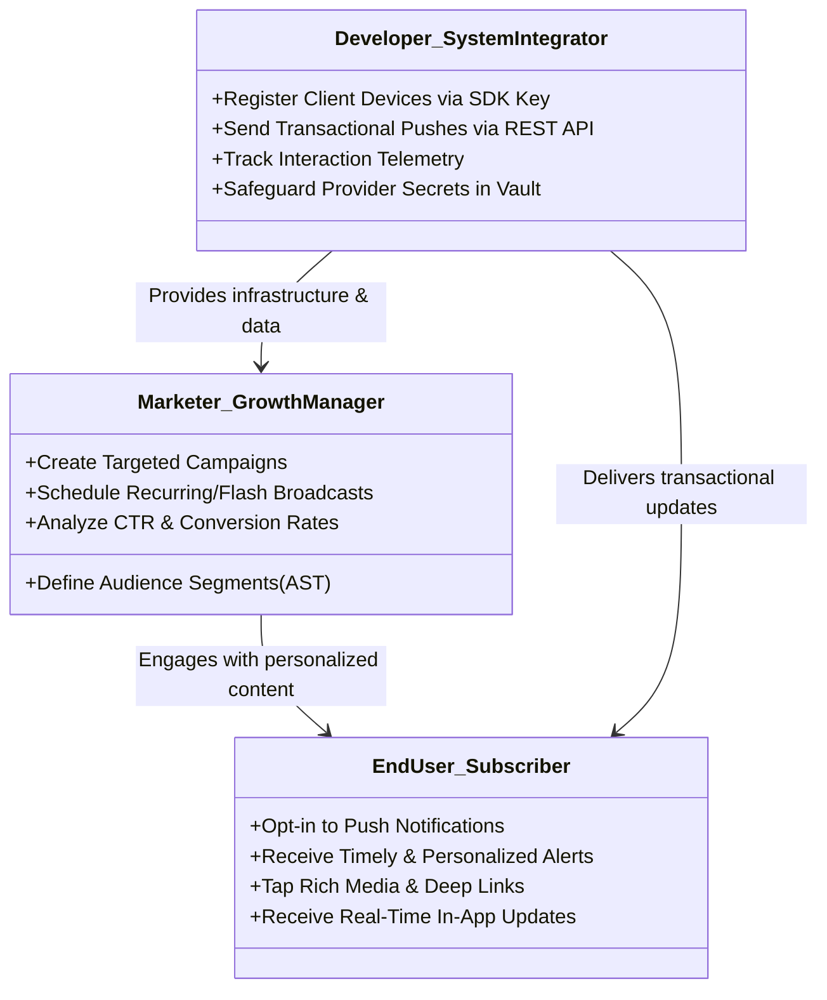
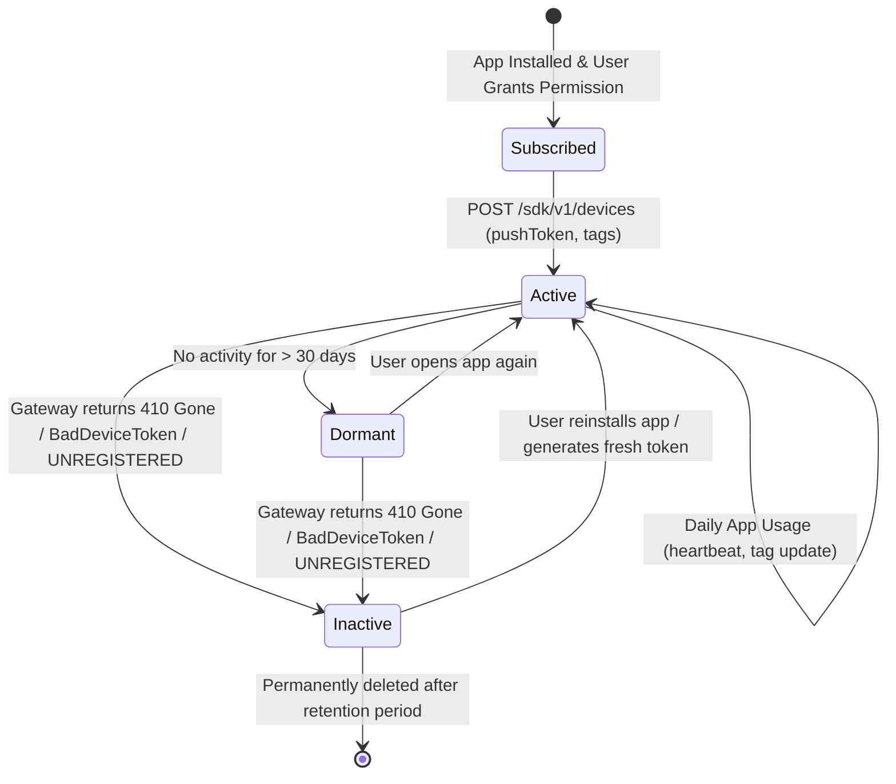
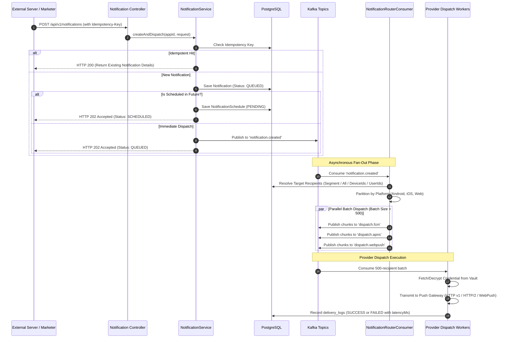

# Business Flows, Personas & System Lifecycles

> **Document Version:** 1.0  
> **Target Audience:** Product Managers, Software Engineers, Solution Architects  
> **Purpose:** Detailed explanation of the platform's business logic, user personas, operational lifecycles, and state transitions.

---

## 1. System Personas & Value Proposition

To understand the business flows, we first define the three core actors interacting with the push platform:



### 1.1 The Marketer / Growth Manager
- **Goals:** Increase user retention, promote flash events, recover dormant users, and boost conversion rates.
- **Tools:** The Vue 3 Web Portal (`Dashboard`, `Segment Builder`, `Notification Composer`, `Analytics`).
- **Core Needs:** Complex audience filtering without writing SQL, scheduling notifications in local timezones, previewing recipient counts, and tracking click-through rates (CTR).

### 1.2 The End User / Subscriber
- **Goals:** Receive valuable, relevant updates (e.g., flight status, security alerts, flash discounts) without being spammed.
- **Experience:** Smooth push registration prompt, rich notifications with images/icons, direct deep linking into specific app screens, and real-time alerts when actively using the app.

### 1.3 The Developer / Backend Integrator
- **Goals:** Reliable, low-latency API integration with high throughput, zero downtime, and strict security.
- **Tools:** Public SDK Client Keys (`os_pub_...`), Server REST API Keys (`os_live_...`), OpenAPI 3 / Swagger docs, WebSocket STOMP endpoints.
- **Core Needs:** Idempotency to prevent accidental double-sends, clear error classification, and automatic handling of dead device tokens.

---

## 2. The Five Core Business Lifecycles

```mermaid
flowchart TD
    subgraph L1["1. Tenant Onboarding"]
        Org[Create Organization] --> App[Create App]
        App --> Vault[Configure AES-GCM Vault Credentials]
        Vault --> Keys[Generate REST & SDK Keys]
    end

    subgraph L2["2. Subscriber & Device Lifecycle"]
        Prompt[User Grants Permission] --> Reg[Register Device Token + Tags]
        Reg --> Active[Active Device State]
        Active -->|Token Invalidated by Apple/Google| Inactive[Deactivate Device (is_active=false)]
    end

    subgraph L3["3. Audience Segmentation"]
        Rules[Define Filter AST: Tags, Platform, Recency] --> Query[Dynamic SQL Criteria Compilation]
        Query --> Matched[Target Audience Device Set]
    end

    subgraph L4["4. Campaign Orchestration & Dispatch"]
        Compose[Compose Title, Body, Deep Link] --> Sched{Scheduled or Immediate?}
        Sched -->|Immediate| Router[Kafka Fan-Out & Batching]
        Sched -->|Scheduled| ShedLock[Distributed Scheduler (ShedLock)]
        ShedLock --> Router
        Router --> Gateways[FCM / APNs / WebPush Workers]
    end

    subgraph L5["5. Telemetry & Analytics Feedback"]
        Gateways --> DeliveryLog[(delivery_logs)]
        UserTap[User Clicks Notification] --> SDKEvent[Emit DELIVERED / OPENED Event]
        SDKEvent --> KafkaEvent[Kafka events.ingest]
        KafkaEvent --> Rollup[Analytics Aggregation & CTR Rollup]
    end

    L1 --> L2
    L2 --> L3
    L3 --> L4
    L4 --> L5
```

---

## 3. Deep Dive: Lifecycle 1 — Tenant Onboarding & App Setup

### Business Logic
The platform is built from the ground up for multi-tenancy. An enterprise can have multiple **Organizations** (e.g., *Acme Retail Corp*, *FinTech Global*), and each organization can host multiple **Applications** (e.g., *Acme Android App*, *Acme iOS App*, *Acme Web Storefront*).

```
Organization (Acme Corp)
 ├── App 1: Acme E-Commerce (Android + iOS + Web)
 │    ├── Provider Credentials (FCM JSON, APNs p8, VAPID)
 │    ├── API Keys (os_live_..., os_pub_...)
 │    ├── Devices & Subscriptions
 │    └── Campaigns & Delivery Logs
 └── App 2: Acme Courier Delivery (Android Driver App)
```

### Key Workflow Steps
1. **Organization Creation:** Initialized with enterprise subscription tier, role-based access control (RBAC), and owner membership.
2. **Application Provisioning:** Scoped uniquely by `(organization_id, name)`.
3. **Encrypted Credential Ingestion:**
   - Apple APNs: `.p8` private key, Key ID (10 chars), Team ID (10 chars), Bundle ID (`com.acme.app`).
   - Google FCM: Service Account JSON (`project_id`, `private_key`, `client_email`).
   - Web Push: VAPID Public & Private key pair generated automatically or provided manually.
   - **Security Invariant:** All private keys and JSON secrets pass through `CryptoVaultService` where they are encrypted with AES-256-GCM. Plaintext secrets are never stored in the database.
4. **API Key Generation:**
   - `KeyType.SERVER_REST`: Starts with `os_live_...` for backend server-to-server operations (dispatching pushes, exporting logs).
   - `KeyType.SDK_PUBLIC`: Starts with `os_pub_...` for public mobile/web client apps (device registration, event tracking). Restricted scopes prevent clients from creating notifications.

---

## 4. Deep Dive: Lifecycle 2 — Subscriber & Device Management

### Business Logic
A device represents a single physical installation of the mobile app or browser subscription.



### Key Business Invariants
1. **Unique Push Token Deduplication:**
   - The database enforces `UNIQUE(app_id, push_token)`.
   - When a device registers with an existing token, the system performs an **UPSERT**: it preserves historical data, updates the `external_user_id`, sets `is_active = true`, updates metadata (`os_version`, `app_version`), and refreshes `last_active_at`.
2. **Flexible Tagging (EAV Pattern):**
   - Devices can hold arbitrary custom key-value tags (`tier: gold`, `purchases: 12`, `vip: true`, `preferred_store: downtown`).
   - Tags are indexed in `device_tags` for fast set-intersection queries during audience segmentation.
3. **Automatic Token Hygiene (Churn Management):**
   - When users uninstall mobile apps or revoke browser permissions, Apple/Google gateways report errors on the next push attempt.
   - The dispatch worker captures these specific error codes (`BadDeviceToken`, `Unregistered`, `410 Gone`, `NOT_FOUND`) and immediately invokes `deactivateDevice(appId, token)`.
   - **Business Value:** Prevents wasting server memory, network bandwidth, and third-party rate limits on millions of abandoned devices.

---

## 5. Deep Dive: Lifecycle 3 — Dynamic Audience Segmentation Engine

### Business Logic
Rather than requiring marketers to upload static CSV lists before every campaign, the platform features a **Dynamic Boolean Filter Engine (Abstract Syntax Tree)**. When a campaign runs, the segment evaluates against live device data in real time.

### AST Structure
A segment consists of logical conjunctions (`AND` / `OR`) and atomic filter rules:

```json
{
  "conjunction": "AND",
  "rules": [
    { "field": "platform", "op": "EQ", "value": "ANDROID" },
    { "field": "tag", "tagKey": "tier", "op": "EQ", "value": "gold" },
    { "field": "last_active_days", "op": "LTE", "value": 7 }
  ],
  "groups": [
    {
      "conjunction": "OR",
      "rules": [
        { "field": "language", "op": "EQ", "value": "en" },
        { "field": "language", "op": "EQ", "value": "km" }
      ]
    }
  ]
}
```

### Supported Filter Operators
| Field | Operator (`op`) | Description | Example |
| :--- | :--- | :--- | :--- |
| `platform` | `EQ`, `NEQ`, `IN` | Target OS family | `ANDROID`, `IOS`, `WEB` |
| `tag` | `EQ`, `NEQ`, `CONTAINS`, `EXISTS`, `GTE`, `LTE` | Custom user metadata | `tagKey: "plan"`, `op: "EQ"`, `value: "premium"` |
| `last_active_days` | `LTE`, `GTE` | Recency / Dormancy | `value: 14` (active within last 14 days) |
| `language` | `EQ`, `NEQ`, `IN` | Device locale | `en`, `es`, `km`, `fr` |
| `timezone` | `EQ`, `CONTAINS` | Geolocation / Timezone | `America/New_York`, `Asia/Phnom_Penh` |
| `app_version` | `EQ`, `GTE`, `LTE` | Client software release | `value: "2.4.0"` |

### Execution Mechanism
`SegmentSpecificationBuilder` converts the JSON AST directly into a SQL `Specification<Device>` query with parameterized criteria, avoiding SQL injection and executing set intersections via indexed joins on `device_tags`.

---

## 6. Deep Dive: Lifecycle 4 — Notification Orchestration & Dispatch Pipeline

### Business Logic
Notifications can be triggered via two channels:
1. **Interactive Marketer UI:** In the Vue 3 Web Portal (`/admin/api/v1/apps/{appId}/notifications`).
2. **Automated Server REST API:** Automated backend triggers (`POST /api/v1/notifications` with `X-Api-Key`).



---

## 7. Deep Dive: Lifecycle 5 — Telemetry & Analytics Attribution

### Business Logic
Once a notification reaches a device, the business needs to know:
1. Did the user receive the notification? (**Delivered Rate**)
2. Did the user tap or open the notification? (**Click-Through Rate / CTR**)
3. Which campaign, platform, or segment generated the highest user engagement?

### Mathematical Definitions
$$\text{Delivery Rate} = \frac{\sum \text{Delivered Events}}{\sum \text{Sent Messages}} \times 100\%$$

$$\text{Click-Through Rate (CTR)} = \frac{\sum \text{Opened} + \sum \text{Clicked}}{\sum \text{Delivered}} \times 100\%$$

### Event Ingestion Buffer
- High-volume push notifications can trigger millions of client receipts within seconds. Writing them directly to a transactional database would cause severe database write locks.
- **Solution:** The Mobile/Web SDK posts events in batches to `POST /sdk/v1/events`. The controller immediately enqueues the batch onto Kafka topic `events.ingest`.
- `EventIngestConsumer` writes the events in buffered micro-batches to the PostgreSQL `events` table.
- `AnalyticsService` computes hourly and daily rollups used by the dashboard's analytics charts.
