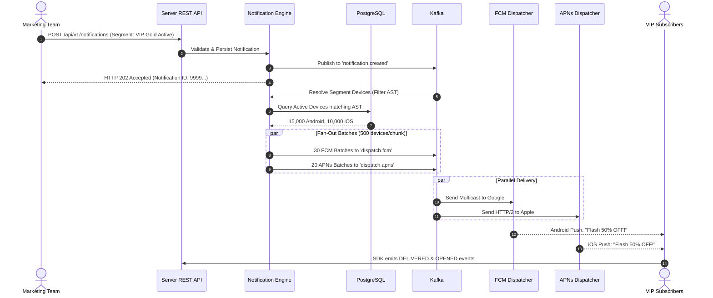
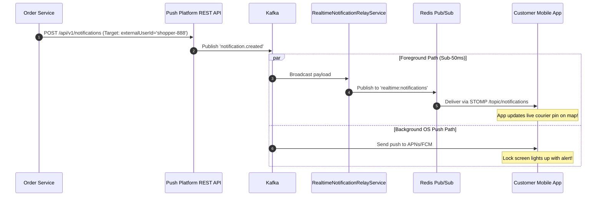
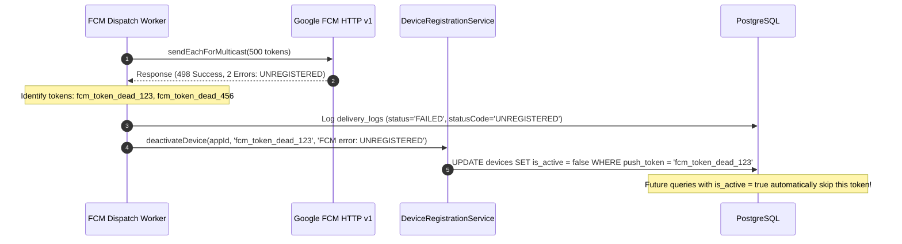

# Real-World Business Scenarios & Step-by-Step Examples

> **Document Version:** 1.0  
> **Target Audience:** Developers, QA Engineers, System Integrators, Technical Reviewers  
> **Purpose:** Detailed end-to-end walkthroughs of real production use cases with complete request/response payloads, database state transitions, and worker processing flows.

---

## 1. Scenario 1: E-Commerce 50% Flash Sale (Segmented VIP Audience)

### 1.1 Business Objective
Acme Retail Store is launching a 2-hour weekend flash sale. The marketing team wants to notify only **VIP Gold Members** who have used the app within the **last 7 days**, localized in **English** and **Khmer**, without bothering low-activity users.



### 1.2 Step 1: Mobile Devices Register and Tag Themselves
When shoppers log in, the mobile app uses the public SDK key (`X-Sdk-Key: os_pub_demo9876543210abcdef9876543210`) to register push tokens and assign tags:

```http
POST /sdk/v1/devices HTTP/1.1
Host: api.pushnotify.local
X-Sdk-Key: os_pub_demo9876543210abcdef9876543210
Content-Type: application/json

{
  "platform": "ANDROID",
  "pushToken": "fcm_dK9s_sample_token_8821947",
  "externalUserId": "shopper-888",
  "deviceModel": "Samsung Galaxy S24",
  "osVersion": "Android 14",
  "appVersion": "3.2.0",
  "language": "en",
  "timezone": "America/New_York",
  "tags": {
    "tier": "gold",
    "vip": "true",
    "total_orders": "14"
  }
}
```

**Database State (`devices` & `device_tags`):**
```sql
-- devices table
INSERT INTO devices (id, app_id, external_user_id, platform, push_token, is_active, last_active_at)
VALUES ('d1111111-1111-1111-1111-111111111111', '11111111-2222-3333-4444-555555555551', 'shopper-888', 'ANDROID', 'fcm_dK9s...', true, NOW());

-- device_tags table (indexed key-value pairs)
INSERT INTO device_tags (device_id, tag_key, tag_value) VALUES
('d1111111-1111-1111-1111-111111111111', 'tier', 'gold'),
('d1111111-1111-1111-1111-111111111111', 'vip', 'true'),
('d1111111-1111-1111-1111-111111111111', 'total_orders', '14');
```

---

### 1.3 Step 2: Marketer Creates Audience Segment
In the Vue 3 Web Portal, the marketer saves a segment named **"VIP Gold Active"** with this AST:

```http
POST /admin/api/v1/apps/11111111-2222-3333-4444-555555555551/segments HTTP/1.1
Authorization: Bearer <ADMIN_JWT>
Content-Type: application/json

{
  "name": "VIP Gold Active (7 Days)",
  "description": "Gold VIP members active within the last week",
  "filterAst": {
    "conjunction": "AND",
    "rules": [
      { "field": "tag", "tagKey": "tier", "op": "EQ", "value": "gold" },
      { "field": "tag", "tagKey": "vip", "op": "EQ", "value": "true" },
      { "field": "last_active_days", "op": "LTE", "value": 7 }
    ],
    "groups": [
      {
        "conjunction": "OR",
        "rules": [
          { "field": "language", "op": "EQ", "value": "en" },
          { "field": "language", "op": "EQ", "value": "km" }
        ]
      }
    ]
  }
}
```

---

### 1.4 Step 3: Triggering the Campaign via Server REST API
The promotion engine or marketer triggers the campaign using the REST API Key:

```http
POST /api/v1/notifications HTTP/1.1
Host: api.pushnotify.local
X-Api-Key: os_live_demo1234567890abcdef1234567890
Idempotency-Key: flash-sale-weekend-20261110
Content-Type: application/json

{
  "title": "⚡ Weekend Flash Sale: 50% OFF VIP Exclusive!",
  "body": "Special 50% discount unlocked for your VIP Gold membership. Valid for 2 hours only!",
  "imageUrl": "https://cdn.acme.com/promotions/flash50_banner.jpg",
  "deepLink": "acme://promotions/flash50?source=push",
  "priority": "HIGH",
  "targetType": "SEGMENT",
  "targetPayload": {
    "segmentId": "88888888-4444-4444-4444-444444444441"
  },
  "customData": {
    "campaign_id": "flash_50_nov",
    "discount_code": "VIP50"
  }
}
```

**Response (Instant, non-blocking):**
```json
{
  "id": "99999999-7777-6666-5555-444433332221",
  "appId": "11111111-2222-3333-4444-555555555551",
  "title": "⚡ Weekend Flash Sale: 50% OFF VIP Exclusive!",
  "status": "QUEUED",
  "targetType": "SEGMENT",
  "createdAt": "2026-11-10T09:30:00Z"
}
```

---

### 1.5 Step 4: Router Worker Fan-Out & Batch Chunking
1. `NotificationRouterConsumer` receives `NotificationCreatedEvent`.
2. Compiles the segment AST into SQL and fetches matching active devices.
3. Groups devices by platform (`ANDROID`, `IOS`, `WEB`).
4. Slices 15,000 Android devices into 30 chunks of 500 recipients.
5. Emits 30 messages to Kafka topic `dispatch.fcm`.
6. Slices 10,000 iOS devices into 20 chunks of 500 recipients.
7. Emits 20 messages to Kafka topic `dispatch.apns`.

---

### 1.6 Step 5: Telemetry Tracking
When the customer unlocks their phone and taps the notification, the mobile SDK sends interaction telemetry:

```http
POST /sdk/v1/events HTTP/1.1
X-Sdk-Key: os_pub_demo9876543210abcdef9876543210
Content-Type: application/json

{
  "events": [
    {
      "notificationId": "99999999-7777-6666-5555-444433332221",
      "deviceId": "d1111111-1111-1111-1111-111111111111",
      "eventType": "DELIVERED",
      "timestamp": "2026-11-10T09:30:03Z"
    },
    {
      "notificationId": "99999999-7777-6666-5555-444433332221",
      "deviceId": "d1111111-1111-1111-1111-111111111111",
      "eventType": "OPENED",
      "timestamp": "2026-11-10T09:30:15Z"
    }
  ]
}
```

The campaign performance dashboard immediately updates with delivery rates, open rates, and CTR analytics!

---

## 2. Scenario 2: High-Priority Transactional Order Update & Real-Time In-App Alert

### 2.1 Business Objective
A customer places an order on a delivery service. When the driver departs the restaurant, the backend sends a real-time update.
- **Dual Delivery Requirement:**
  - If the user is currently looking at the app: Display an immediate animated map popup via **WebSocket STOMP**.
  - If the user's phone is locked in their pocket: Display a lock screen notification with high priority via **Apple APNs / Google FCM**.



### 2.2 API Dispatch Payload

```http
POST /api/v1/notifications HTTP/1.1
Host: api.pushnotify.local
X-Api-Key: os_live_demo1234567890abcdef1234567890
Content-Type: application/json

{
  "title": "🛵 Your order is on the way!",
  "body": "Driver Alex has picked up your food and is arriving in 8 minutes.",
  "priority": "HIGH",
  "targetType": "EXTERNAL_USER_IDS",
  "targetPayload": {
    "externalUserIds": ["shopper-888"]
  },
  "deepLink": "acme://orders/ORD-98214",
  "customData": {
    "order_id": "ORD-98214",
    "driver_name": "Alex",
    "driver_lat": 11.5564,
    "driver_lng": 104.9282,
    "eta_minutes": 8
  }
}
```

### 2.3 Result
1. The WebSocket listener on the client receives the payload in $< 40\text{ ms}$, animating the driver icon without needing the user to refresh.
2. The APNs worker sends a rich push to iOS with an APNs priority header `apns-priority: 10`, ensuring immediate delivery even in iOS Low Power Mode.

---

## 3. Scenario 3: Automated Re-Engagement Campaign with Distributed Scheduling (ShedLock)

### 3.1 Business Objective
Every morning at 09:00 AM, the marketing system wants to send a re-engagement nudge to dormant users who haven't opened the app in 14 to 30 days.

### 3.2 Scheduling via the API
The marketing automation service schedules the notification for tomorrow morning:

```http
POST /api/v1/notifications HTTP/1.1
X-Api-Key: os_live_demo1234567890abcdef1234567890
Content-Type: application/json

{
  "title": "We miss you! Here is 20% off your next order",
  "body": "Use promo code WELCOMEBACK20 today only.",
  "priority": "NORMAL",
  "targetType": "SEGMENT",
  "targetPayload": {
    "segmentId": "77777777-3333-3333-3333-333333333331"
  },
  "scheduledAt": "2026-11-11T09:00:00Z",
  "scheduleType": "FIXED_TIME"
}
```

### 3.3 ShedLock Clustered Execution
When the clock strikes `09:00:00 UTC`:
1. Three instances of `push-platform-backend` are running in Kubernetes/Docker.
2. Spring's `@Scheduled(fixedDelay = 5000)` fires on all 3 nodes.
3. `@SchedulerLock(name = "campaign_scheduler_trigger", lockAtLeastFor = "PT2S", lockAtMostFor = "PT10S")` attempts to set a Redis lock key.
4. **Node 1** acquires the lock; **Node 2** and **Node 3** skip execution.
5. Node 1 queries `notification_schedules` for records with `status = 'PENDING'` and `scheduled_at <= NOW()`.
6. The schedule transitions to `status = 'TRIGGERED'`, and Node 1 publishes `NotificationCreatedEvent` to Kafka.
7. **Business Guarantee:** Duplicate pushes are mathematically impossible even during horizontal autoscaling.

---

## 4. Scenario 4: Token Invalidation & Churn Recovery (Automatic Dead Token Deactivation)

### 4.1 Business Objective
Users frequently delete apps, switch phones, or reset device identifiers. Sending push notifications to abandoned tokens wastes compute, exhausts third-party rate limits, and damages delivery reputation.



### 4.2 Error Classification Table

| Provider | Gateway Error Code / Status | Meaning | System Action |
| :--- | :--- | :--- | :--- |
| **Apple APNs** | `410 BadDeviceToken` / `Unregistered` | App was uninstalled or token expired | `deactivateDevice()` sets `is_active = false` |
| **Apple APNs** | `429 TooManyRequests` | Temporary provider rate limit | Worker retries with exponential backoff |
| **Google FCM** | `UNREGISTERED` / `NOT_FOUND` | App uninstalled or user cleared storage | `deactivateDevice()` sets `is_active = false` |
| **Google FCM** | `QUOTA_EXCEEDED` / `UNAVAILABLE` | Temporary GCP quota exhaustion | Worker retries; fallback to DLQ if permanent |
| **Web Push** | `410 Gone` / `404 Not Found` | Browser push subscription revoked | `deactivateDevice()` sets `is_active = false` |
| **Web Push** | SSRF Violation (e.g. `169.254.169.254`) | Malicious endpoint URL | Abort immediately; record security audit log |

### 4.3 Database Audit Trail
Reviewers can inspect the deactivation in the `delivery_logs` table:

```sql
SELECT device_id, provider, status, status_code, error_message, latency_ms, created_at 
FROM delivery_logs 
WHERE status = 'FAILED' 
ORDER BY created_at DESC 
LIMIT 5;
```

Output:
| device_id | provider | status | status_code | error_message | latency_ms | created_at |
| :--- | :--- | :--- | :--- | :--- | :--- | :--- |
| `d111...` | `FCM` | `FAILED` | `UNREGISTERED` | `The registration token is no longer valid` | 42 | 2026-11-10 09:30:02 |
| `d222...` | `APNS` | `FAILED` | `BadDeviceToken`| `Device token is invalid or expired` | 65 | 2026-11-10 09:30:02 |
