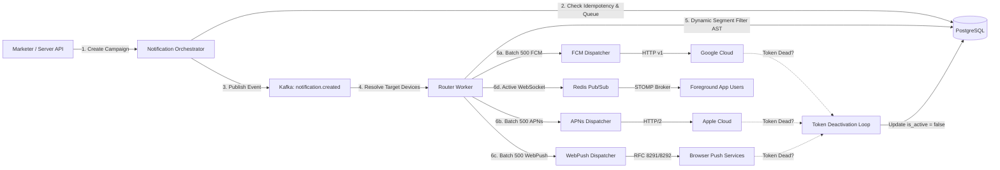

# Enterprise Push Notification Platform: Business & System Documentation

> **Welcome to the Unified Multi-Tenant Push Notification Engine.**  
> This directory (`/docs`) provides engineers, product managers, and reviewers with a comprehensive guide to the system's business objectives, core architectural workflows, real-world operational examples, and developer integration patterns.

---

## 1. What Problem Does This System Solve?

In modern mobile and web ecosystems, engaging users across platforms (Android, iOS, Web browsers) typically requires integrating with fragmented, vendor-specific protocols:
- **Google FCM (Firebase Cloud Messaging):** OAuth2 service accounts, HTTP v1 multicast, Android notification channels.
- **Apple APNs (Apple Push Notification service):** HTTP/2 multiplexing, PKCS#8 `.p8` token authentication, topic bundle IDs, collapse IDs.
- **W3C Web Push:** RFC 8291 / 8292 standards, VAPID key pairs, ECDH key agreements, browser push services (Google Chrome, Mozilla Firefox, Apple Safari, Microsoft Edge).

Commercial notification SaaS vendors (like OneSignal, Braze, Iterable, Airship) charge steep recurring monthly fees as subscriber counts climb into millions, lock customer data into proprietary clouds, and risk GDPR / data sovereignty non-compliance.

### How This Platform Helps Businesses
| Strategic Advantage | Business Value | Real-World Impact |
| :--- | :--- | :--- |
| **Unified Push Gateway** | Send a single message to millions of devices across iOS, Android, and Web with one API call. | Developers write one integration; marketers manage one unified campaign dashboard. |
| **Massive Cost Savings (90%+)** | Self-hosted infrastructure eliminates per-subscriber and per-message SaaS tier fees. | Processing 10M pushes/month costs ~$50-$100 in cloud compute vs. $3,000-$10,000+/month with SaaS vendors. |
| **Strict Data Sovereignty & Multi-Tenancy** | Organizations, customer tags, device identifiers, and credentials are completely isolated in private PostgreSQL databases. | Meets strict HIPAA, GDPR, and enterprise compliance requirements. |
| **Sub-Second Throughput via Kafka** | Non-blocking asynchronous message ingestion fans out to parallel worker queues in chunks of 500 recipients. | Eliminates gateway bottlenecks during flash sales, breaking news, and urgent security broadcasts. |
| **Automatic Token Hygiene & Churn Recovery** | Automatically listens to provider gateway feedback (410 Gone, `BadDeviceToken`, `UNREGISTERED`) and deactivates dead device tokens. | Prevents wasted compute bandwidth and preserves high sender reputation with Apple and Google. |
| **Real-Time Foreground + Background Delivery** | Combines background OS pushes with low-latency WebSocket STOMP relays for users actively inside the app. | Zero-delay in-app updates with unified delivery logging. |

---

## 2. Documentation Index

The documentation is organized into modular guides designed for rapid comprehension:

```
docs/
├── README.md                           # System Vision, Business Value & Documentation Map (This file)
├── process.md                          # Simple, Step-by-Step Architecture, Problem-Solving & Integration Guide
├── ADMIN_PLAYGROUND_GUIDE.md           # Step-by-Step Admin Frontend Playground & End-to-End Verification Runbook
├── ONESIGNAL_COMPARISON.md             # In-Depth Architecture, Process & Cost Comparison: This Platform vs. OneSignal
├── 01_BUSINESS_FLOW_AND_LIFECYCLE.md   # Core Business Flows, Personas, and Operational Lifecycles
├── 02_REAL_WORLD_EXAMPLES.md           # Step-by-Step Practical Scenarios (Payloads, DB, Workers)
├── 03_DEVELOPER_INTEGRATION_GUIDE.md   # Quickstart, REST/SDK Integration, Architecture Cheatsheet
└── 04_SETUP_AND_OPERATIONS_MANUAL.md   # Startup Runbook, Developer Setup & Admin User Guide
```

### Quick Links:
0. [**Process, System Mechanics & Integration Guide (`process.md`)**](process.md): Plain-English walkthrough of how the system works, 8 problems solved one by one, startup configs, mobile/web integration, and FAQ.
1. [**Admin Frontend Playground & Verification Guide (`ADMIN_PLAYGROUND_GUIDE.md`)**](ADMIN_PLAYGROUND_GUIDE.md): Hands-on UI click-by-click playground walkthrough for testing all features, verifying endpoints, triggers, and backend states.
2. [**OneSignal Comparison Guide (`ONESIGNAL_COMPARISON.md`)**](ONESIGNAL_COMPARISON.md): Architectural, process, financial (90%+ savings), and feature matrix comparison between this platform and OneSignal SaaS.
3. [**01. Business Flow & Lifecycle**](01_BUSINESS_FLOW_AND_LIFECYCLE.md): Understand the 3 key personas (Marketer, App User, Developer) and the 5 critical lifecycles (Tenant Onboarding, Device Subscription, Audience Segmentation, Campaign Dispatch, Telemetry Attribution).
4. [**02. Real-World Examples**](02_REAL_WORLD_EXAMPLES.md): Detailed walkthroughs of E-commerce Flash Sales, Transactional OTP alerts, Dormant User Re-engagement, and Token Churn Handling with concrete JSON payloads and database state transitions.
5. [**03. Developer Integration Guide**](03_DEVELOPER_INTEGRATION_GUIDE.md): Practical API reference, SDK quickstart, Kafka topic architecture, and operational runbook for engineers onboarding onto the codebase.
6. [**04. Setup & Operations Manual**](04_SETUP_AND_OPERATIONS_MANUAL.md): Complete prerequisites, bare-metal vs Docker startup runbook, initial developer credentials vault configuration, and comprehensive admin app management guide for client onboarding.

---

## 3. High-Level System Workflow at a Glance



---

## 4. Key Performance Indicators (KPIs) & Target Metrics

| Metric | Target SLA | Implementation Mechanism |
| :--- | :--- | :--- |
| **API Ingestion Latency** | $< 35\text{ ms}$ ($p99$) | Immediate persistence with Kafka event buffering; returns `HTTP 202 Accepted`. |
| **Fan-Out Throughput** | $> 100{,}000\text{ devices/min}$ | Kafka multi-partition parallel consumer workers chunked in batches of 500. |
| **Delivery Reliability** | $99.9\%+$ At-Least-Once | Distributed retry policies with Dead Letter Queue (`dispatch.dlq`). |
| **Scheduled Trigger Precision**| $\pm 5\text{ seconds}$ | Distributed ShedLock execution across Redis clusters. |
| **Security & Privacy** | AES-256-GCM Vault | Master-key envelope encryption for all gateway credentials with SSRF IP filters. |
