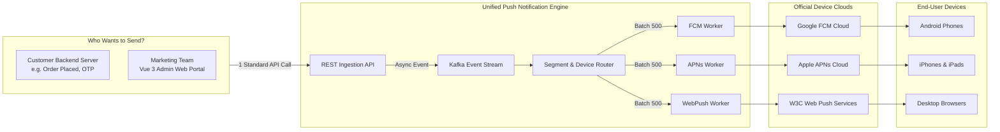
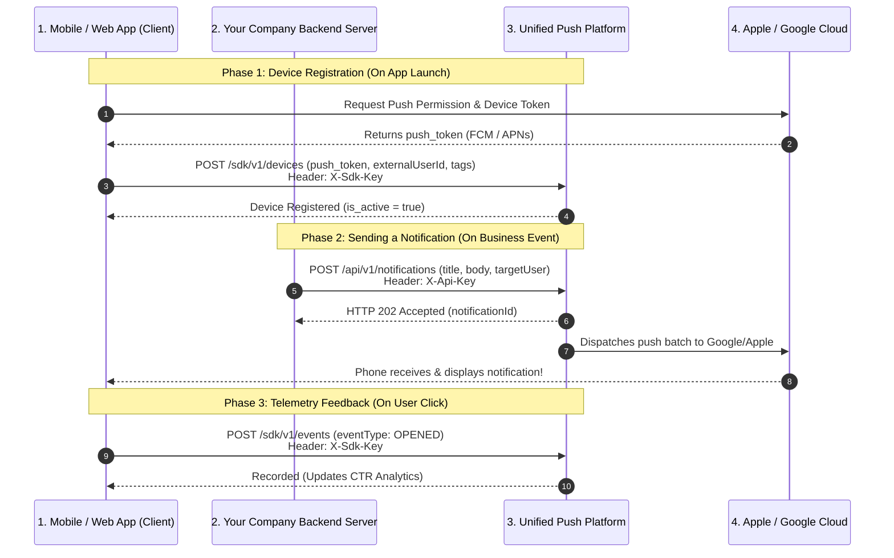
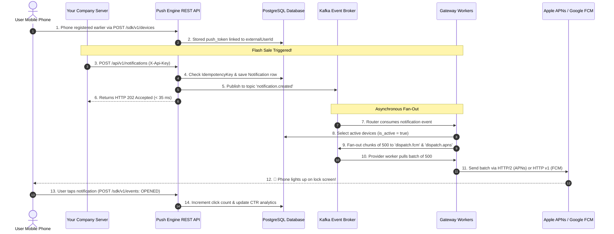

# System Process, Architecture & Integration Guide (`process.md`)

> **Document Purpose:** An intuitive, step-by-step explanation of how the Unified Multi-Tenant Push Notification Engine works, why it exists, how it solves real-world engineering problems one by one, how to start and test it, and how external applications (Mobile, Web, Backend) integrate with it.

---

## Table of Contents
1. [The Big Picture: What is this System and Why Do We Need It?](#1-the-big-picture-what-is-this-system-and-why-do-we-need-it)
2. [Part 1: How the System Works & Solves Problems One by One](#part-1-how-the-system-works--solves-problems-one-by-one)
   - [Problem 1: The "Tower of Babel" of Push Gateways (Fragmented Protocols)](#problem-1-the-tower-of-babel-of-push-gateways-fragmented-protocols)
   - [Problem 2: The "Flash Sale" Spike (Sending Millions Without Crashing)](#problem-2-the-flash-sale-spike-sending-millions-without-crashing)
   - [Problem 3: Ghost Devices & Gateway Blacklisting (Token Churn)](#problem-3-ghost-devices--gateway-blacklisting-token-churn)
   - [Problem 4: Accidental Double-Sends (Idempotency)](#problem-4-accidental-double-sends-idempotency)
   - [Problem 5: Security Leaks & Data Privacy in Multi-Tenancy](#problem-5-security-leaks--data-privacy-in-multi-tenancy)
   - [Problem 6: Targeting Customers Without Writing Complex SQL (Segments)](#problem-6-targeting-customers-without-writing-complex-sql-segments)
   - [Problem 7: Scheduled Campaigns Across Multi-Server Clusters (Race Conditions)](#problem-7-scheduled-campaigns-across-multi-server-clusters-race-conditions)
   - [Problem 8: Foreground In-App Alerts vs. Background OS Push](#problem-8-foreground-in-app-alerts-vs-background-os-push)
3. [Part 2: Requirements & Configs to Start and Test](#part-2-requirements--configs-to-start-and-test)
   - [2.1 Prerequisites Checklist](#21-prerequisites-checklist)
   - [2.2 Port & Network Map](#22-port--network-map)
   - [2.3 Key Configuration Files & Settings](#23-key-configuration-files--settings)
   - [2.4 Step-by-Step Launch Options (Local Dev vs. Full Docker)](#24-step-by-step-launch-options-local-dev-vs-full-docker)
   - [2.5 How to Test & Verify (Automated & Manual)](#25-how-to-test--verify-automated--manual)
4. [Part 3: How This System Integrates with Other Applications](#part-3-how-this-system-integrates-with-other-applications)
   - [3.1 The 3-Party Integration Architecture](#31-the-3-party-integration-architecture)
   - [3.2 Authentication & API Keys Requirements](#32-authentication--api-keys-requirements)
   - [3.3 Mobile & Web Client Integration (Android, iOS, Web)](#33-mobile--web-client-integration-android-ios-web)
   - [3.4 Customer Backend Server Integration (Dispatching Pushes)](#34-customer-backend-server-integration-dispatching-pushes)
5. [Part 4: Easy-to-Understand Explanations & FAQ](#part-4-easy-to-understand-explanations--faq)
   - [The 10-Second Life of a Notification (Visual Sequence)](#the-10-second-life-of-a-notification-visual-sequence)
   - [Plain-English Glossary of Terms](#plain-english-glossary-of-terms)
   - [Frequently Asked Questions (FAQ)](#frequently-asked-questions-faq)

---

## 1. The Big Picture: What is this System and Why Do We Need It?

### The "Airport Courier Hub" Analogy
Imagine an international e-commerce company that ships parcels all over the world:
- Some parcels must go via **Federal Express (Apple iOS)**.
- Some parcels must go via **DHL (Google Android)**.
- Some parcels must go via **Local Postal Couriers (Web Browsers: Chrome, Safari, Firefox)**.

Without a central logistics hub:
- Every time a product is purchased, the e-commerce store staff would need to pack three different boxes, write three different customs declarations in three foreign languages, stand in line at three different post offices, and wait hours for receipts.
- If they have 1,000,000 orders during Black Friday, the staff would freeze, customer orders would get lost, and the store would crash.

### What This Platform Does
This platform is the **Central Automated Courier Sorting Facility**:
1. Your company (Backend Server or Marketing Team) sends **one single standardized order** to this platform: *"Send this 40% discount announcement to all VIP members"*.
2. The platform instantly confirms receipt in **30 milliseconds** (`202 Accepted`) so your server never waits.
3. Behind the scenes, high-speed sorting machines (Apache Kafka workers) look up the members, group them by platform (Android, iOS, Web), translate the message into Apple/Google/Web specifications, pack them into batches of 500, and fire them in parallel to Apple, Google, and Web Push servers.
4. When users tap the notification on their phones, the platform counts the clicks and displays a live delivery graph on your dashboard.



---

## Part 1: How the System Works & Solves Problems One by One

### Problem 1: The "Tower of Babel" of Push Gateways (Fragmented Protocols)

#### The Problem:
Every operating system requires a completely different, incompatible protocol to receive notifications:
- **Apple (iOS/macOS):** Requires permanent HTTP/2 network pipes, complex binary cryptography with `.p8` private keys, Team IDs, Key IDs, and Apple Bundle IDs.
- **Google (Android):** Requires HTTP v1 with Google Cloud IAM OAuth2 short-lived access tokens generated from a service account JSON file.
- **Web Browsers (Chrome, Firefox, Safari):** Requires W3C Web Push protocol (RFC 8291 / 8292), VAPID public/private key pairs, and elliptic-curve Diffie-Hellman (ECDH) payload encryption.

If your backend team tries to implement this directly, you must write and maintain 3 completely separate integration stacks.

#### How This System Solves It:
- **Unified Gateway Adapter:** The platform abstracts all 3 protocols behind a single standard API endpoint (`POST /api/v1/notifications`).
- You send one simple JSON payload with `title`, `body`, and optional `customData`.
- The engine automatically handles OAuth2 token refreshing with Google, HTTP/2 connection pooling with Apple, and VAPID curve encryption with browsers.

---

### Problem 2: The "Flash Sale" Spike (Sending Millions Without Crashing)

#### The Problem:
Suppose an e-commerce app has **2,000,000 subscribers** and announces a 2-hour Flash Sale.
- If your web server sends pushes synchronously inside an HTTP request loop, the server will time out after 30 to 60 seconds.
- Memory usage spikes, threads get exhausted, and normal users cannot even browse your website.

#### How This System Solves It:
- **Non-Blocking Asynchronous Fan-Out via Apache Kafka:**
  1. When your server calls `POST /api/v1/notifications`, the platform does NOT contact Apple or Google immediately.
  2. It validates the request, records the notification in PostgreSQL, publishes an event to Kafka topic `notification.created`, and immediately returns `HTTP 202 Accepted` to your server in **< 35 ms**.
  3. A background **Router Worker** consumes the Kafka event and queries the database for target devices using cursor-based pagination.
  4. The router slices the target devices into chunks of **500 recipients per batch** and publishes them to platform-specific Kafka queues:
     - `dispatch.fcm` (for Android)
     - `dispatch.apns` (for iOS)
     - `dispatch.webpush` (for Web)
  5. Dedicated consumer worker pools process these batches in parallel without ever slowing down the API or blocking client transactions.

---

### Problem 3: Ghost Devices & Gateway Blacklisting (Token Churn)

#### The Problem:
Mobile users frequently uninstall apps, wipe their phones, or revoke push notification permissions.
- When an app is uninstalled, its push token dies.
- If you continue sending notifications to dead tokens, Apple and Google will flag your account for abuse, throttle your transmission speeds, or ban your server certificate.

#### How This System Solves It:
- **Automated Gateway Feedback & Self-Healing Token Hygiene:**
  - Whenever a worker sends a push, it reads the status code returned by the push gateway:
    - **Google FCM:** Returns `404 NOT_FOUND` or error code `UNREGISTERED`.
    - **Apple APNs:** Returns `410 Gone` or error reason `BadDeviceToken` / `Unregistered`.
    - **Web Push:** Returns `410 Gone` or `404 Not Found`.
  - The worker immediately identifies the dead token and updates PostgreSQL:
    ```sql
    UPDATE devices SET is_active = false, updated_at = NOW() WHERE push_token = '...';
    ```
  - That dead token is instantly removed from all future campaign calculations. Zero wasted bandwidth, zero risk of gateway blacklisting.

---

### Problem 4: Accidental Double-Sends (Idempotency)

#### The Problem:
A marketer clicks "Send Campaign" and the browser lags for 2 seconds. The marketer clicks "Send" again. Or, an automated backend script experiences a network glitch and retries the HTTP request.
- Without protection, 1,000,000 customers receive the exact same notification twice. If the notification says *"Your account was debited $50"*, customers panic and call customer support.

#### How This System Solves It:
- **Atomic Idempotency Guard:**
  - Clients can pass an `Idempotency-Key: <unique-uuid-or-order-id>` HTTP header.
  - The platform checks Redis and PostgreSQL for this key.
  - If a notification with this key already exists or is currently processing, the system **rejects the duplicate** and returns the existing notification status. The campaign is sent exactly once.

---

### Problem 5: Security Leaks & Data Privacy in Multi-Tenancy

#### The Problem:
In an enterprise setup, multiple clients or business departments (e.g. *Retail*, *FinTech*, *Logistics*) share the infrastructure.
- If push credentials (e.g., Apple `.p8` private keys or Google Service Account secrets) are stored in plaintext in the database, a database breach or compromised backup exposes every client's push authority.
- Also, malicious web push endpoints could attempt Server-Side Request Forgery (SSRF) against internal cloud infrastructure (like AWS metadata IP `169.254.169.254`).

#### How This System Solves It:
- **AES-256-GCM Envelope Encryption (Crypto Vault):**
  - All private keys and service account JSONs pass through `CryptoVaultService`.
  - They are encrypted using AES-256-GCM with a Master Key before storage in PostgreSQL. Plaintext keys never touch the disk.
- **Tenant Context Isolation:**
  - Requests are authenticated via JWT or API Key and bound to a ThreadLocal `TenantContext`. All SQL queries automatically enforce `WHERE app_id = ?`.
- **SSRF Hardening:**
  - Web Push endpoints are resolved against an IP blacklist before sending HTTP requests, blocking access to private network ranges (`10.0.0.0/8`, `192.168.0.0/16`, `169.254.169.254`).

---

### Problem 6: Targeting Customers Without Writing Complex SQL (Segments)

#### The Problem:
Marketing teams want to send promotions like: *"Send to Android users who are VIP Gold members, speak English, and opened the app in the last 7 days."*
- Marketers do not know SQL.
- If developers write ad-hoc SQL queries every time marketing has an idea, development slows down, and slow unindexed queries can crash the database.

#### How This System Solves It:
- **Visual Dynamic AST (Abstract Syntax Tree) Segment Engine:**
  - The Vue 3 portal provides a visual rule builder.
  - The frontend sends a clean JSON structure:
    ```json
    {
      "conjunction": "AND",
      "rules": [
        { "field": "platform", "operator": "EQUALS", "value": "ANDROID" },
        { "field": "tags.tier", "operator": "EQUALS", "value": "gold" },
        { "field": "last_active_at", "operator": "GREATER_THAN", "value": "now-7d" }
      ]
    }
    ```
  - The backend safely compiles this JSON tree into a parameterized, highly optimized PostgreSQL query with indexed tag joins.
  - Marketers can click **Preview Recipient Count** to instantly see how many users match before sending.

---

### Problem 7: Scheduled Campaigns Across Multi-Server Clusters (Race Conditions)

#### The Problem:
A marketing campaign is scheduled for 9:00 AM tomorrow.
- In production, you run 3 or 4 instances of the backend application for high availability.
- When 9:00 AM arrives, if all 4 instances run a scheduled timer, the campaign will be sent **4 times** to every subscriber.

#### How This System Solves It:
- **Distributed Locking via ShedLock & Redis:**
  - When the scheduled cron triggers, all backend instances attempt to acquire a distributed lock in Redis (`push_platform:scheduled_campaigns`).
  - Exactly **one instance** wins the lock and initiates the Kafka dispatch. The other instances detect the lock and exit gracefully.

---

### Problem 8: Foreground In-App Alerts vs. Background OS Push

#### The Problem:
When a user is actively looking at your app on their screen (foreground), receiving a loud OS push notification from the top of their screen is jarring or ignored. However, when the app is closed, only an OS push can wake the phone up.

#### How This System Solves It:
- **Dual-Channel Delivery (OS Gateways + WebSocket STOMP):**
  - When devices open your app, they can establish a lightweight WebSocket STOMP connection to `/ws`.
  - When a notification is dispatched, if the user has an active WebSocket session, the platform relays the message in real time across cluster nodes via Redis Pub/Sub directly to the app screen.
  - If the user is offline or the app is closed, the system delivers the notification through the native OS push gateways (Apple APNs or Google FCM).

---

## Part 2: Requirements & Configs to Start and Test

### 2.1 Prerequisites Checklist

Before running or testing the system, make sure your machine meets these requirements:

| Component | Minimum Specification | Why It Is Required |
| :--- | :--- | :--- |
| **Operating System** | Linux (Ubuntu/Debian/Fedora), macOS 13+, or Windows 11 (WSL2) | Platform runs native containers and POSIX scripts. |
| **Java JDK (CRITICAL)** | **Amazon Corretto Java 21 LTS** (`21.0.10-amzn`) | ⚠️ **DO NOT USE Java 25:** Default host Java 25 breaks Lombok compilation with `TypeTag :: UNKNOWN`. Java 21 LTS is mandatory. |
| **Node.js & npm** | Node.js `v18.x` or `v20.x` LTS, npm `v9+` | For building and running the Vue 3 Admin Portal. |
| **Docker & Compose** | Docker `v24+`, Docker Compose `v2.20+` | For containerizing PostgreSQL 17, Redis 7, and Kafka 3.7. |
| **Apache Maven** | Maven `v3.9+` | For compiling and running the Spring Boot 3.3.4 backend. |
| **Hardware** | 2 vCPUs, 4 GB RAM (Dev); 4+ vCPUs, 8+ GB RAM (Prod) | Kafka, PostgreSQL, and Spring Boot memory requirements. |

---

### 2.2 Port & Network Map

When the system boots, the following ports are bound on `localhost`:

```
┌────────────────────────────────────────────────────────────────────────┐
│                        LOCAL HOST MACHINE                              │
│                                                                        │
│   [ Port 5173 ]  ──>  Vue 3 Admin Web Portal (Vite Dev Server)         │
│   [ Port 3001 ]  ──>  Vue 3 Admin Web Portal (Docker Nginx Mode)       │
│   [ Port 8080 ]  ──>  Spring Boot REST API + WebSocket STOMP (/ws)     │
│   [ Port 54327]  ──>  PostgreSQL 17 Database (Mapped to container 5432)│
│   [ Port 6380 ]  ──>  Redis 7 Cache / ShedLock (Mapped to cont 6379)   │
│   [ Port 9092 ]  ──>  Apache Kafka 3.7 Event Broker                    │
└────────────────────────────────────────────────────────────────────────┘
```

> **Note on Database Port:** The PostgreSQL host port is mapped to `54327` (instead of standard `5432`) to prevent port conflicts if you already have a local PostgreSQL instance running on your host machine.

---

### 2.3 Key Configuration Files & Settings

All backend settings are located in:
`PushNotificationSys/backend/src/main/resources/application.yml`

You can customize them directly in the YAML or via environment variables:

```yaml
server:
  port: 8080                              # REST API and WebSocket port

spring:
  datasource:
    # Connects to PostgreSQL on host port 54327
    url: jdbc:postgresql://${DB_HOST:localhost}:${DB_PORT:54327}/${DB_NAME:push_platform}
    username: ${DB_USER:postgres}
    password: ${DB_PASSWORD:postgres_password}
  data:
    redis:
      # Connects to Redis on host port 6380
      host: ${REDIS_HOST:localhost}
      port: ${REDIS_PORT:6380}
  kafka:
    # Connects to Kafka broker on host port 9092
    bootstrap-servers: ${KAFKA_BOOTSTRAP_SERVERS:localhost:9092}

app:
  jwt:
    # 256-bit secret for signing Admin Dashboard tokens (HS256)
    secret: ${JWT_SECRET:4z7x9w2v8y5k1m3p6r9t0q4s7u2w5x8z1a3c5e7g9i1k3m5o7q9s1u3w5y7z9a1b}
    access-token-expiration-seconds: 900       # 15 minutes
    refresh-token-expiration-seconds: 604800   # 7 days
  crypto:
    # 256-bit AES-GCM Master Key for encrypting provider credentials (FCM JSON / APNs p8)
    master-key: ${CRYPTO_MASTER_KEY:k4P8q3Z1y7W2v9T0x5R8u1O3m6L9j2H5g7E0b3D6a8=}
```

---

### 2.4 Step-by-Step Launch Options (Local Dev vs. Full Docker)

You have two choices to start the system:

#### Option A: Local Developer Mode (Recommended for Fast Iteration & Hot Reload)
In this mode, Docker runs only the database, cache, and messaging infrastructure, while you run Spring Boot and Vue 3 directly on your host machine for instant code reloading.

```bash
# Step 1: Open terminal and navigate to project folder
cd /media/menglanghuo/Menglang/Bronx/PushNotificationSys/PushNotificationSys

# Step 2: Start background infrastructure (PostgreSQL, Redis, Kafka)
docker compose up -d postgres redis kafka

# Step 3: Verify the containers are running and healthy
docker compose ps

# Step 4: Export Java 21 path (MANDATORY)
export JAVA_HOME=/home/menglanghuo/.sdkman/candidates/java/21.0.10-amzn
export PATH=$JAVA_HOME/bin:$PATH
java -version   # Must output 21.x (NOT 25.x)

# Step 5: Start Spring Boot backend
mvn spring-boot:run -f backend/pom.xml
# Backend will boot on http://localhost:8080 and automatically run database migrations V1 to V5.

# Step 6: In a second terminal, launch the Vue 3 Admin Portal
cd /media/menglanghuo/Menglang/Bronx/PushNotificationSys/PushNotificationSys/frontend
npm install
npm run dev
# Portal opens on http://localhost:5173
```

#### Option B: 1-Click Full Docker Compose Stack
If you do not want to install Java or Node.js on your machine, you can run all 5 services in Docker:

```bash
cd /media/menglanghuo/Menglang/Bronx/PushNotificationSys/PushNotificationSys

# Build and start all 5 containers (Postgres, Redis, Kafka, Backend, Frontend)
docker compose up -d --build

# View logs from backend
docker compose logs -f backend
```
- Access Admin Portal: `http://localhost:3001`
- Access Backend API / Swagger: `http://localhost:8080/swagger-ui/index.html`

---

### 2.5 How to Test & Verify (Automated & Manual)

#### 1. Run the Automated Verification Script
The repository includes an end-to-end smoke test script that executes all critical workflows in sequence:
```bash
cd /media/menglanghuo/Menglang/Bronx/PushNotificationSys/PushNotificationSys
bash scripts/verify_platform.sh
```

**What this script verifies automatically:**
1. Tests Actuator health (`/actuator/health` returns `UP`).
2. Checks Swagger / OpenAPI docs (`/v3/api-docs` returns `200 OK`).
3. Authenticates as Super Admin (`admin@pushnotify.local`) and receives a JWT token.
4. Registers an **Android device** using the public SDK key (`X-Sdk-Key`).
5. Registers a **Web Push device** with VAPID crypto keys.
6. Dispatches a **Push Notification** using the server REST key (`X-Api-Key`).
7. Ingests client interaction telemetry (`DELIVERED` and `OPENED` events).
8. Queries the live Analytics dashboard endpoint.
9. Exports delivery logs as a CSV file.
10. Fires rapid burst requests to verify Redis token-bucket rate limiting (`X-RateLimit-Remaining`).

#### 2. Manual Verification via Web Test Benches
Once the app is running:
- **Web Push Test Bench:** Open `http://localhost:5173`, log in, navigate to **Apps > [Your App] > Web Push Test**. Click **Subscribe to Web Push**, then click **Send Test Notification**. Your desktop browser will display a native notification popup!
- **Realtime WebSocket Test Bench:** Navigate to **Apps > [Your App] > Realtime Gateway** to verify active WebSocket STOMP message broadcasting.

---

## Part 3: How This System Integrates with Other Applications

### 3.1 The 3-Party Integration Architecture

When integrating your ecosystem with this platform, there are **three distinct roles**:



---

### 3.2 Authentication & API Keys Requirements

Every Application created in the platform generates **two distinct API keys**:

| Key Type | Key Prefix | Where It Lives | What Permissions It Has | Example Use Case |
| :--- | :--- | :--- | :--- | :--- |
| **`SDK_PUBLIC`** | `os_pub_...` | Embedded inside iOS, Android, or Web client code. | **Write-Only Restricted:** Register devices (`device:write`), emit telemetry (`event:write`). Cannot create campaigns. | Mobile app registers device token when user opens the app. |
| **`SERVER_REST`** | `os_live_...` | Kept secret on your backend server (environment variable). | **Privileged Backend:** Create notifications (`notification:create`), read logs, query subscribers. | Your backend sends an order shipping alert or OTP code. |

---

### 3.3 Mobile & Web Client Integration (Android, iOS, Web)

#### Step 1: Requirements for Client Apps
1. The client app needs the public SDK key: `X-Sdk-Key: os_pub_...`
2. The user's unique identifier in your system (e.g. `user_id_123` or email) passed as `externalUserId`.
3. Custom attributes (e.g. `tier: gold`, `language: en`) passed as `tags`.

---

#### Client Implementation Code:

##### A. Android (Kotlin with FirebaseMessaging)
```kotlin
// 1. Get native push token from Google Play Services
FirebaseMessaging.getInstance().token.addOnCompleteListener { task ->
    if (task.isSuccessful) {
        val fcmToken = task.result
        registerDeviceWithPushPlatform(fcmToken)
    }
}

// 2. Register token with the Unified Push Platform
fun registerDeviceWithPushPlatform(token: String) {
    val json = JSONObject().apply {
        put("platform", "ANDROID")
        put("pushToken", token)
        put("externalUserId", CurrentUser.id) // e.g. "user_1002"
        put("deviceModel", Build.MODEL)
        put("osVersion", "Android ${Build.VERSION.RELEASE}")
        put("language", Locale.getDefault().language)
        put("timezone", TimeZone.getDefault().id)
        put("tags", JSONObject().apply {
            put("tier", "vip")
            put("subscribed_category", "electronics")
        })
    }

    val request = Request.Builder()
        .url("https://push.yourcompany.com/sdk/v1/devices")
        .addHeader("X-Sdk-Key", "os_pub_your_public_key_here")
        .post(json.toString().toRequestBody("application/json".toMediaType()))
        .build()

    OkHttpClient().newCall(request).execute()
}
```

##### B. Apple iOS (Swift in AppDelegate)
```swift
func application(_ application: UIApplication, didRegisterForRemoteNotificationsWithDeviceToken deviceToken: Data) {
    // 1. Convert binary token to hex string
    let tokenString = deviceToken.map { String(format: "%02.2hhx", $0) }.joined()

    // 2. Register with Unified Push Platform
    let payload: [String: Any] = [
        "platform": "IOS",
        "pushToken": tokenString,
        "externalUserId": CurrentUser.id,
        "deviceModel": UIDevice.current.model,
        "osVersion": UIDevice.current.systemVersion,
        "language": Locale.current.languageCode ?? "en",
        "timezone": TimeZone.current.identifier,
        "tags": ["tier": "vip", "device": "iphone"]
    ]

    var request = URLRequest(url: URL(string: "https://push.yourcompany.com/sdk/v1/devices")!)
    request.httpMethod = "POST"
    request.addValue("os_pub_your_public_key_here", forHTTPHeaderField: "X-Sdk-Key")
    request.addValue("application/json", forHTTPHeaderField: "Content-Type")
    request.httpBody = try? JSONSerialization.data(withJSONObject: payload)

    URLSession.shared.dataTask(with: request).resume()
}
```

##### C. Web Browser (JavaScript + Service Worker)
```javascript
// 1. Ask user for permission and subscribe via browser PushManager
const registration = await navigator.serviceWorker.register('/service-worker.js');
const subscription = await registration.pushManager.subscribe({
    userVisibleOnly: true,
    applicationServerKey: urlB64ToUint8Array("YOUR_VAPID_PUBLIC_KEY")
});

// 2. Extract encryption keys (p256dh and auth)
const p256dh = btoa(String.fromCharCode.apply(null, new Uint8Array(subscription.getKey('p256dh'))));
const auth = btoa(String.fromCharCode.apply(null, new Uint8Array(subscription.getKey('auth'))));

// 3. Register device with Push Platform
await fetch('https://push.yourcompany.com/sdk/v1/devices', {
    method: 'POST',
    headers: {
        'Content-Type': 'application/json',
        'X-Sdk-Key': 'os_pub_your_public_key_here'
    },
    body: JSON.stringify({
        platform: 'WEB',
        pushToken: subscription.endpoint,
        webP256dhKey: p256dh,
        webAuthKey: auth,
        externalUserId: 'user_1002',
        deviceModel: navigator.userAgent,
        tags: { browser: 'chrome' }
    })
});
```

---

### 3.4 Customer Backend Server Integration (Dispatching Pushes)

Whenever your backend needs to send a notification (e.g., *Order Shipped*, *New Message*, *Password Changed*, or *Marketing Broadcast*), it calls `POST /api/v1/notifications`.

#### Header Requirements:
- `X-Api-Key: os_live_...` (Your privileged server REST key)
- `Content-Type: application/json`
- `Idempotency-Key: <unique-order-id>` (Optional, protects against duplicate sends)

#### Targeting Options:
You can target recipients in **4 different ways**:
1. `targetType: "EXTERNAL_USER_IDS"`: Target specific users by their ID in your database (e.g. `["user_1001", "user_1002"]`).
2. `targetType: "SEGMENT"`: Target a pre-defined audience segment (e.g. *All Gold VIPs active in last 7 days*).
3. `targetType: "DEVICE_IDS"`: Target specific physical device UUIDs.
4. `targetType: "ALL"`: Broadcast to all active devices registered under this app.

---

#### Example Backend Dispatch Code:

##### Node.js / TypeScript Example:
```typescript
import axios from 'axios';

async function sendOrderNotification(userId: string, orderId: string) {
    const payload = {
        title: "Order Shipped! 📦",
        body: `Your order #${orderId} is out for delivery.`,
        priority: "HIGH",
        targetType: "EXTERNAL_USER_IDS",
        targetPayload: {
            externalUserIds: [userId]
        },
        customData: {
            orderId: orderId,
            deepLinkUrl: `app://orders/${orderId}`
        }
    };

    const response = await axios.post('https://push.yourcompany.com/api/v1/notifications', payload, {
        headers: {
            'Content-Type': 'application/json',
            'X-Api-Key': process.env.PUSH_PLATFORM_API_KEY, // os_live_...
            'Idempotency-Key': `order-shipped-${orderId}`     // Prevents double-send
        }
    });

    console.log("Notification accepted with ID:", response.data.id); // HTTP 202 Accepted
}
```

##### Python Example:
```python
import requests

def send_flash_sale():
    headers = {
        "Content-Type": "application/json",
        "X-Api-Key": "os_live_your_live_key_here",
        "Idempotency-Key": "flash-sale-2026-11-10"
    }
    payload = {
        "title": "⚡ 50% Flash Sale Starts Now!",
        "body": "Tap to grab your exclusive discount before items sell out.",
        "priority": "HIGH",
        "targetType": "SEGMENT",
        "targetPayload": {
            "segmentId": "3fa85f64-5717-4562-b3fc-2c963f66afa6"
        },
        "customData": {
            "campaign": "nov_flash"
        }
    }
    response = requests.post("http://localhost:8080/api/v1/notifications", json=payload, headers=headers)
    print("Status:", response.status_code, "Body:", response.json())
```

##### cURL Example:
```bash
curl -X POST http://localhost:8080/api/v1/notifications \
  -H "X-Api-Key: os_live_demo1234567890abcdef1234567890" \
  -H "Content-Type: application/json" \
  -H "Idempotency-Key: order-update-994" \
  -d '{
    "title": "Payment Confirmed",
    "body": "We have received your payment of $120.",
    "priority": "HIGH",
    "targetType": "ALL"
  }'
```

---

## Part 4: Easy-to-Understand Explanations & FAQ

### The 10-Second Life of a Notification (Visual Sequence)

Here is exactly what happens behind the scenes from the microsecond your backend calls the API until the phone lights up:



---

### Plain-English Glossary of Terms

| Term | What It Means in Simple Words |
| :--- | :--- |
| **Push Token** | A temporary physical digital address given to an app by Apple or Google (like a temporary telephone number). It allows servers to send messages to that specific phone. |
| **External User ID** | Your own database's user ID (e.g. `user_8842` or `alice@gmail.com`). This system maps one `externalUserId` to multiple devices (e.g. Alice's iPhone, iPad, and Laptop). |
| **Idempotency Key** | A unique transaction ticket (e.g., `order-12345`). If you accidentally submit the same request twice, the system recognizes the ticket and ignores the second send. |
| **Fan-Out** | The process of taking one single message and multiplying it out to millions of individual device addresses in parallel queues. |
| **Token Churn / 410 Gone** | When a user deletes an app, Apple/Google tells the sender *"This phone number is dead (410 Gone)"*. The platform automatically marks the token inactive. |
| **AST (Abstract Syntax Tree)** | A structured JSON format for audience filters (e.g. `Platform == Android AND Plan == Gold`) that avoids writing raw SQL. |
| **ShedLock** | A distributed digital padlock stored in Redis that prevents multiple running servers from executing the same scheduled campaign at the same second. |
| **VAPID** | Voluntary Application Server Identification. An open standard cryptographic key pair used to send notifications to Web Browsers without paying a vendor. |

---

### Frequently Asked Questions (FAQ)

#### Q1: "Why can't my backend just talk directly to Apple and Google?"
You can, but you will quickly run into three severe hurdles:
1. **Three completely different protocols:** Apple uses HTTP/2 with binary `.p8` keys; Google uses HTTP v1 with OAuth2 tokens; Web browsers use VAPID with ECDH curves.
2. **Performance bottleneck:** Sending 500,000 pushes sequentially from your backend will freeze your application for hours or cause out-of-memory crashes.
3. **Token hygiene:** If you don't build a feedback loop to deactivate dead tokens, Apple and Google will penalize your delivery reputation or ban your account.

#### Q2: "Why does the API return `202 Accepted` instead of `200 OK`?"
In HTTP standards:
- `200 OK` means *"The work is completely done and delivered."*
- `202 Accepted` means *"We received your request, verified your credentials, and scheduled it for background processing."*
Because sending to millions of devices takes several seconds or minutes, returning `202 Accepted` allows your backend server to respond to your users immediately in **under 35 milliseconds** without blocking.

#### Q3: "Can one user have multiple devices (e.g., an iPhone and an Android tablet)?"
**Yes!** The system is designed for this:
- When a user logs in on their iPhone, the iPhone registers with `externalUserId: "user_123"`.
- When the same user logs in on their Android tablet, the tablet registers with `externalUserId: "user_123"`.
- When your backend sends a notification to `externalUserIds: ["user_123"]`, the engine automatically finds **both devices** and delivers the notification to both the iPhone and the tablet simultaneously.

#### Q4: "What happens if a user uninstalls our mobile app?"
When the system tries to deliver a notification to an uninstalled app, Apple or Google responds with an error (`BadDeviceToken` or `UNREGISTERED`). The system's background worker catches this error and immediately sets `is_active = false` in the database. The dead token will never be contacted again.

#### Q5: "Where are sensitive credentials (Apple `.p8` keys, Google JSON) stored?"
They are never stored in plaintext. They are encrypted using **AES-256-GCM** with a Master Key before being saved to PostgreSQL. Only the worker thread that needs to establish a connection with Apple or Google decrypts the credential in memory.

---

## Summary Checklist to Get Started
1. Run `docker compose up -d postgres redis kafka`
2. Start backend: `mvn spring-boot:run` (using Java 21)
3. Start frontend: `npm run dev`
4. Run automated test: `bash scripts/verify_platform.sh`
5. Configure your client apps with `X-Sdk-Key` and your server with `X-Api-Key`
6. You are ready to send notifications at scale!

> [!TIP]
> **Wondering how this compares to OneSignal SaaS?**  
> Check out the complete breakdown in [**OneSignal Comparison Guide (`ONESIGNAL_COMPARISON.md`)**](file:///media/menglanghuo/Menglang/Bronx/PushNotificationSys/docs/ONESIGNAL_COMPARISON.md) covering architecture, step-by-step process differences, 90%+ cost savings, and migration steps.
